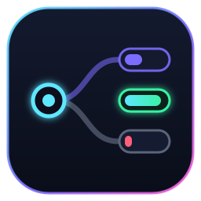

# CLIProxyAPI Safeguard Killer Plugin



This ABI v1 plugin works on stock CLIProxyAPI and does two things:

- **Quota balancing:** when a model is served by two or more credentials (for
  example two Claude Max accounts), each request goes to the credential whose
  quota is most at risk of going unused.
- **Model groups:** virtual models that try a list of real models in order
  until one answers, e.g. `uncensored-models` → `glm-5.3-uncensored` →
  `deepseek-v4.1-flash-uncensored` → `Abliterated Large v2`.

Both are configured from the plugin's page in the Management UI.

## Quota balancing

Each candidate credential is ranked by

```
rate = weight * remaining / hours_until_reset
```

of its longest quota window that applies to the model. A credential that
resets tomorrow with 30% left (1.25%/h) beats one that resets in 6 days with
60% left (0.42%/h), so accounts with different reset days are compared fairly.
`weight` (default 1) scales for plan size, e.g. 20 for Max 20x and 1 for Pro.

- A credential is skipped when any applicable window has less than
  `min_remaining` left.
- Sessions are sticky: a session keeps its credential while prompts keep
  coming. After `idle_minutes` (default 5) without a prompt the prompt cache is
  cold anyway, so the next prompt is ranked again and may move.
- Credentials without quota data (API keys, providers without a usage
  endpoint) are not ranked. If no candidate has data, CPA's own routing policy
  decides.

Quota comes from the same provider usage endpoints the Management Center quota
cards use (Claude, Codex, Antigravity, Kimi, xAI), called through the CPA
management `api-call` endpoint, plus `quota/fetch` for plugin providers such as
OpenCode Go. This needs the management key in `management.key`. A rejected key
stops all management calls until it is changed, so a typo cannot get the
plugin's IP banned.

## Model groups

A group has a codename (the model ID clients request) and a visible name, and
an ordered list of target models. For each request the plugin:

1. skips a target when every credential serving it is below `min_remaining`;
2. runs the target through CPA (full routing, translation and balancing);
3. moves on to the next target when it fails for any reason before the first
   byte of output.

Once a stream has started, a failure ends the request, because output was
already sent. When every target fails, the client gets the last target's
status and a message listing each attempt. Groups cannot contain other groups.

`count_tokens` on a group is answered locally with the `o200k_base` tokenizer,
the same estimate CPA uses for providers without a native count endpoint,
because a group has no single upstream to ask.

## Dashboard

**Quota Smart Router** in the Management UI menu shows every credential with its
quota windows and weight, the active session bindings with their idle
countdown, and the recent decisions: the full ranking behind each balanced
pick, and each group request's attempts. Groups, weights and settings are
edited there and saved to the plugin's config.

## Build

```bash
make test
```

Produces `build/safeguard-killer.so`.

## Install from the management interface

Add this registry URL to `plugins.store-sources`:

```yaml
plugins:
  enabled: true
  store-sources:
    - "https://raw.githubusercontent.com/esauvisky/CLIProxyAPI-Safeguard-Killer-Plugin/main/registry.json"
```

Only one scheduler plugin is active at a time.

## Example `config.yaml`

```yaml
plugins:
  enabled: true
  configs:
    safeguard-killer:
      enabled: true
      management_key: "<management key>"
      min_remaining: 0.02
      idle_minutes: 5
      groups:
        - id: "uncensored-models"
          name: "Uncensored"
          models:
            - "glm-5.3-uncensored"
            - "deepseek-v4.1-flash-uncensored"
            - "Abliterated Large v2"
```
